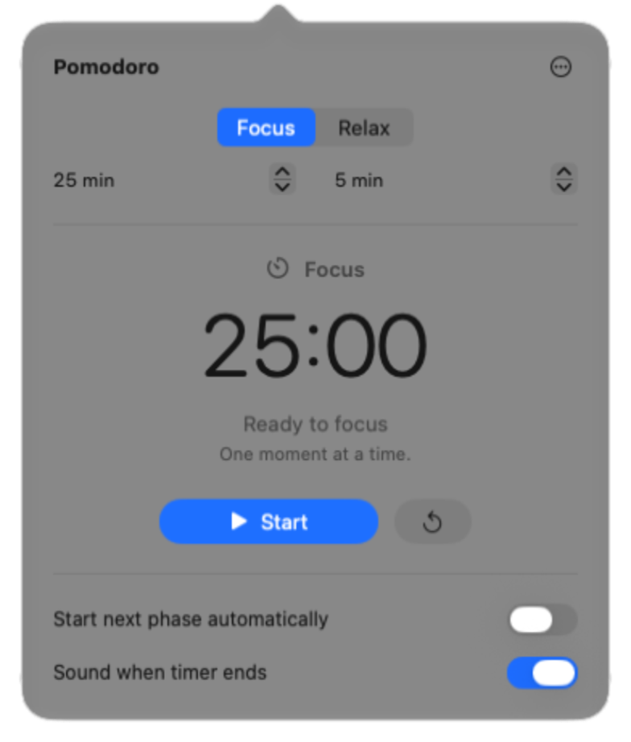

# Pomodoro

A minimal Pomodoro timer for the macOS menu bar. Built with Swift, SwiftUI and AppKit. No accounts, analytics, network access or third-party dependencies.



## Download

**[Download Pomodoro for Mac](https://github.com/nikgava/pomodoro-timer/raw/refs/heads/main/downloads/Pomodoro-macOS-arm64.zip)** — v1.0.1 · Apple Silicon · macOS 14+

Unzip, move **Pomodoro.app** to **Applications** and open it. Click the timer icon in the menu bar. No developer tools required.

The app is signed locally, not notarized by Apple. If macOS blocks the first launch, follow [Apple’s instructions](https://support.apple.com/en-us/102445) to approve it in **System Settings → Privacy & Security → Open Anyway**.

## Features

- Adjustable Focus and Relax timers: 25 and 5 minutes by default, from 1 to 180 minutes each.
- Start, pause, resume and reset. Optional automatic phase switching.
- The panel opens when a phase ends, with optional sound that follows system volume and mute.
- Light and dark appearance, saved preferences and optional launch at login.
- Runs in the menu bar, with no Dock icon. Countdown updates stop when the panel is closed.

## Build from source

Requires an **Apple Silicon Mac**, **macOS 14+** and **Swift 6+** (Xcode 16+ or compatible Apple Command Line Tools).

Download or clone this repository, then run from its folder:

```sh
./scripts/build.sh
```

Builds `dist/Pomodoro.app` and `dist/Pomodoro-macOS-arm64.zip`. Intel Macs are not supported by the build script.

## Usage

Choose Focus or Relax, adjust the duration and press **Start**. Closing the panel keeps the timer running. Duration changes apply the next time that phase starts; reset to apply them immediately.

**Space**: start/pause/resume · **⌘R**: reset · **Esc**: close panel · **⌘Q**: quit.

Timers account for time spent asleep. Quitting ends the current session; preferences are saved locally.

Enable **Open at Login** from the **•••** menu if needed.

## Development

Open `Pomodoro.xcodeproj` in Xcode, or use the build script. Run the automated engine, model and system-service checks with:

```sh
./scripts/test.sh
```

Source is in `Sources/`, tests in `Tests/`. Build output stays in `dist/` and is excluded from Git.
